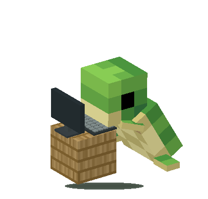

# Baby Turtle

A Windows desktop companion that walks, climbs, naps, and types at a tiny computer while your assistant works. Click the turtle to use Windows voice typing, or attach a screenshot from its right-click menu.

**Early beta · Windows only · No API key required**



## Download and run

For a packaged release, extract the entire ZIP into a writable folder and open **Baby Turtle.exe**. Keep its `src`, `assets`, and `Turtle.ps1` files together; the executable is a host for the bundled source, not a standalone binary. **Start Turtle.cmd** also starts the app.

From a source checkout, open Windows PowerShell in the project folder and run:

```powershell
powershell.exe -NoProfile -STA -ExecutionPolicy Bypass -File ".\Build Turtle.ps1"
```

Then open **Baby Turtle.exe**. Alternatively, **Start Turtle.cmd** can run the script directly before you build the executable; Windows may group that fallback under PowerShell.

Requirements: a Windows desktop session, Windows PowerShell 5.1, and .NET Framework 4.x. Development has been tested on the author's Windows machine; a second-machine installation test is still pending. Windows voice typing also needs a microphone, internet access, and Windows online speech recognition. No macOS or Linux support is included.

This beta executable is unsigned. Build from source if you prefer. The app uses a per-process PowerShell execution-policy setting; it does not change your machine's saved execution policy.

## Link your message box

1. Open your Codex or ChatGPT chat and click its message box.
2. Press **Ctrl+Alt+L** and wait for **Message box linked**.
3. Click elsewhere if you want. Clicking the turtle restores the linked input and requests Windows voice typing.
4. Stop recording with the Windows microphone control. Review the text and send it yourself.

**Ctrl+Alt+Space** also requests voice typing. Without a linked input, focus the intended message box before clicking the turtle. A link identifies the input control, not a permanently selected chat: if the app reuses that control, dictation targets the currently displayed chat. Relink after navigation if the control changes, and after restarting the turtle or the target app. Shortcut conflicts with other apps can prevent linking.

For screenshots, right-click → **Attach screenshot** → choose a monitor or **All monitors**. The app captures before restoring the linked message box, then pastes the image. It keeps the turtle visible and replaces the clipboard contents with the screenshot. Check the attachment thumbnail and send it yourself. The app does not save a screenshot file.

## Assistant reactions

- **Codex:** enabled by default. The turtle follows the most recently used local chat recorded in Codex metadata. It sits at a little wooden workstation during a recorded task and dances on completion. Under **Connections**, toggle **React to Codex activity** or inspect the connection status.
- **ChatGPT Windows app:** focus its window and press **Ctrl+Alt+G**. The turtle watches English accessibility names for response controls. Keep that chat view open. Under **Connections**, inspect or clear this activity link.

The activity link and message-box link are separate. If both assistants are connected, the turtle works while either is busy. ChatGPT's response-ended notification can also mean that you manually stopped the response.

These are compatibility adapters, not official integrations. Codex file formats and ChatGPT accessibility controls can change. Codex tracking follows recent local metadata rather than the live selected tab and does not support remote/cloud Codex sessions. A missing terminal event may leave a stale working state. ChatGPT detection may be unavailable for other languages, app versions, views, or minimized windows. A failed detection is shown in the connection status.

## Pet controls

Right-click the turtle or tray icon for the menu:

| Action | Behavior |
| --- | --- |
| Pet actions | Pat, wave, dance, and sleep/wake |
| Behavior & appearance | Wandering, climbing, reduced motion, size, and idle sleep |
| Try a climb now | Starts an excursion when climbing is enabled and the turtle is available |
| Help turtle up | Rescues him after a fall; clicking his upside-down body also helps |
| Move to bottom of this screen | Resets his position |
| Restart turtle | Saves preferences and reloads the code in a fresh app process |
| Quit | Closes the app |

Drag to carry him. Hover to pause a walk and get a greeting. To wake a sleeping turtle, move directly over his visible body; moving the pointer elsewhere does not wake him.

Movement follows planted flipper strokes and pauses during their return. Climbing is off by default and separate from wandering. He climbs up one side, hangs upside down across the top, and descends headfirst on the other side. He can lose his grip anywhere along that route. He tips onto his back before falling, makes a larger dust puff after a higher drop, and waits for help. Helping rolls him over his side. Assistant activity or disabling climbing triggers a safe descent instead of a random fall.

Preferences are saved beside the app in `turtle.settings`. Restart preserves those preferences but clears temporary input and ChatGPT activity links.

## Privacy and permissions

See [SECURITY.md](SECURITY.md) and the [pre-upload security review](docs/SECURITY_REVIEW.md) for the security scope, completed checks, and remaining validation work.

- No API keys, account credentials, audio recordings, or outgoing chat messages are managed by the turtle.
- Windows handles speech recognition and its network connection. The turtle requests the Windows voice-typing shortcut; the badge does not prove that the microphone is recording.
- Input linking uses Windows UI Automation to remember and focus an editable control, without using its text.
- Codex monitoring reads local recent-chat metadata, session titles, and lifecycle records beneath `CODEX_HOME` or the default `.codex` directory. It does not modify Codex configuration.
- ChatGPT monitoring looks for response buttons in the explicitly linked window; it does not click them or submit prompts.
- Screenshots contain whatever is visible on the selected display. They stay on the clipboard until replaced.
- Startup diagnostics go to `turtle-startup.log`. Settings, logs, generated previews, and release output are excluded from Git.

## Development

The active character comes from the owner's separated Blender model. `assets/baby-turtle.blend` is a prepared project copy with six animation pivots and ordinary flat-color materials; `assets/baby-turtle.mesh.json` contains its normalized geometry and material colors for the Windows renderer. Blinking, walking, typing, climbing, falling, and helping up use the same rigid-part animation system. No texture PNG is required for the character.

To regenerate the runtime mesh after editing the source, run Blender in background mode with `--factory-startup --disable-autoexec --background YOUR_MODEL.blend --python-exit-code 1 --python tools/Export-BlenderModel.py`. The exporter requires the six named parts, retains the input file, saves a prepared project copy, and removes unused reference images from that copy. It supports solid RGB/Principled material colors. Missing runtime mesh data uses the older procedural fallback; malformed mesh data is rejected.

The app compiles C# source using Windows PowerShell at startup. No npm installation or downloaded runtime dependency is needed. Close the executable before rebuilding its host; ordinary source edits only need **Restart turtle**.

```powershell
powershell.exe -NoProfile -STA -ExecutionPolicy Bypass -File .\Turtle.ps1 -Check
powershell.exe -NoProfile -STA -ExecutionPolicy Bypass -File .\Verify-Turtle.ps1
powershell.exe -NoProfile -STA -ExecutionPolicy Bypass -File .\Verify-Codex.ps1
powershell.exe -NoProfile -STA -ExecutionPolicy Bypass -File .\Verify-Adventure.ps1
powershell.exe -NoProfile -STA -ExecutionPolicy Bypass -File .\Verify-Assets.ps1
powershell.exe -NoProfile -STA -ExecutionPolicy Bypass -File .\Verify-BlenderModel.ps1
powershell.exe -NoProfile -ExecutionPolicy Bypass -File .\Verify-UploadSafety.ps1
powershell.exe -NoProfile -STA -ExecutionPolicy Bypass -File .\Verify-Menu.ps1
powershell.exe -NoProfile -STA -ExecutionPolicy Bypass -File .\Verify-Restart.ps1
powershell.exe -NoProfile -STA -ExecutionPolicy Bypass -File ".\Package Release.ps1"
```

Menu and restart checks briefly show native UI. Close any running turtle before the restart check. `Verify-Restart.ps1 -Relaunch` additionally exercises the real launcher and leaves a replacement app running. `Verify-Codex.ps1 -Live` optionally probes local Codex metadata without sending a prompt. Do not use live checks on hosted CI.

`Verify-UploadSafety.ps1` requires a Git checkout and checks files eligible for upload. It does not scan Git history or replace a dedicated secrets scanner.

The Windows workflow checks the normal build and procedural texture fallback, then uploads a release ZIP artifact. `Package Release.ps1` uses an explicit file allowlist, checks the staged source, and creates a SHA-256 checksum under `dist`. It does not publish a GitHub Release.

Automated checks cover geometry, occlusion, stroke timing and frame-rate consistency, pointer reactions, route directions, falls and recovery, assistant event fixtures, screenshot payloads, menu structure, and restart cleanup. They do not establish microphone quality, actual attachment delivery, or compatibility with every version of Codex and ChatGPT. Fresh-machine testing is still needed.

## License and credits

Project code, procedural textures, geometry, and the app icon are **MIT licensed**. See [LICENSE](LICENSE), [CREDITS.md](CREDITS.md), and [CHANGELOG.md](CHANGELOG.md).

Inspired by [gprem09/minecraft_pet_v2](https://github.com/gprem09/minecraft_pet_v2). This is an independent native Windows implementation using the owner's Blender turtle and its material colors. The downloaded STL and old texture-reference images have been removed from the working tree and release packaging. The workstation wood pattern and fallback character are generated in code. Earlier Git commits or remote release assets may still contain retired files; cleanup has not rewritten history. See CREDITS.md for provenance.

Unofficial fan project; not affiliated with Mojang, Microsoft, or OpenAI.
